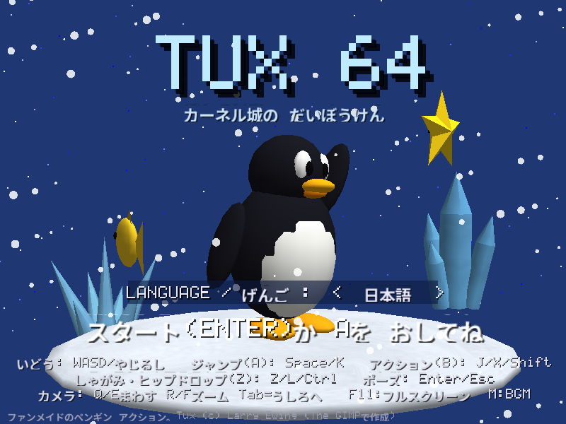
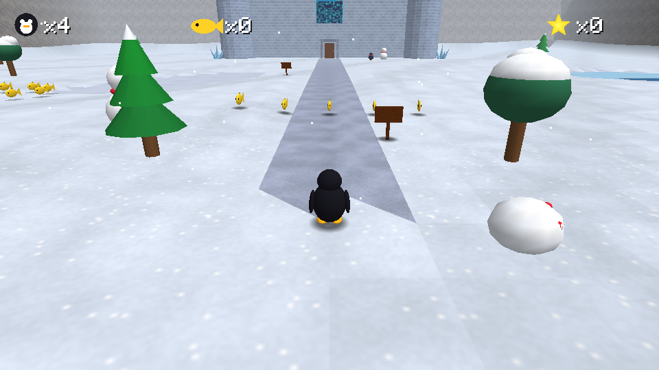
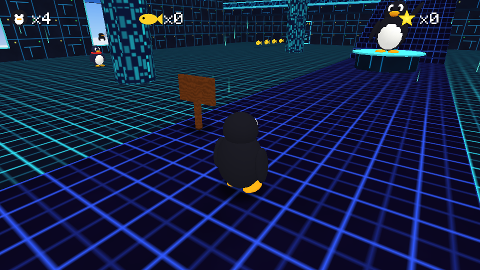
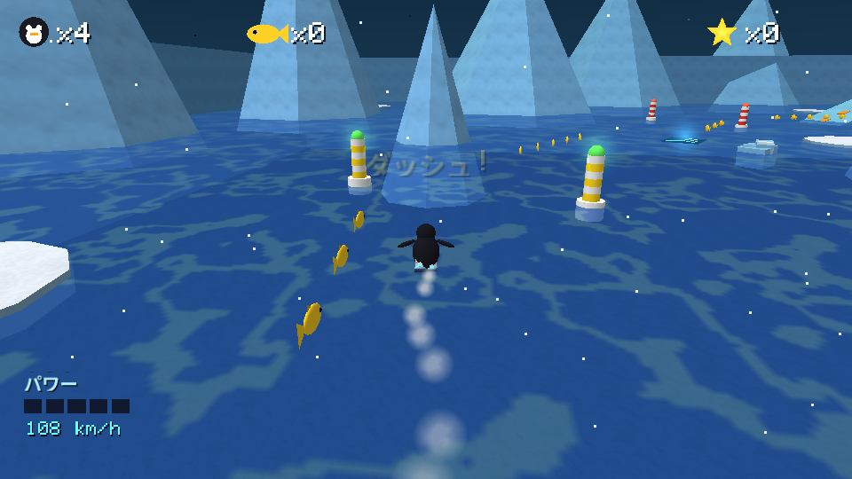
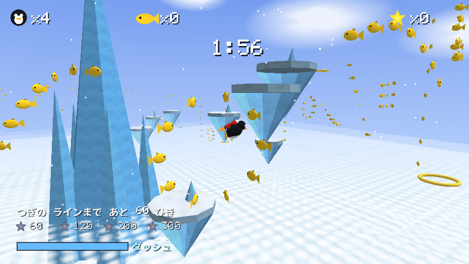
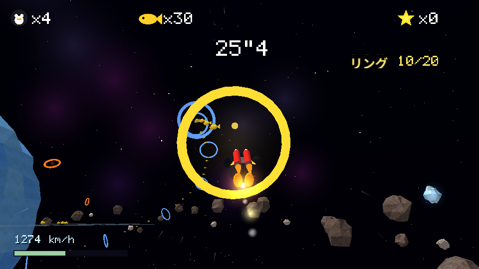
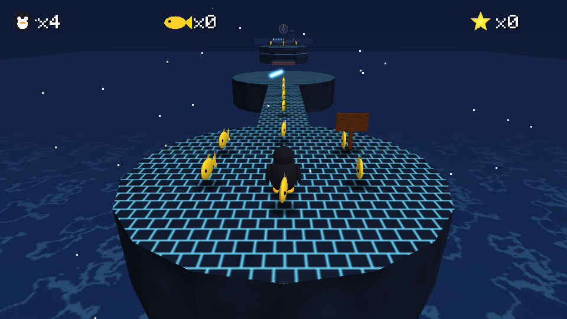

# TUX 64 — The Kernel Castle Adventure

<p align="center">
  
</p>

<table>
  <tr>
    <td width="50%"><br><sub>KERNEL CASTLE GROUNDS — お城の庭</sub></td>
    <td width="50%"><br><sub>KERNEL CASTLE — サイバー空間のお城の中</sub></td>
  </tr>
  <tr>
    <td><br><sub>AURORA SEA RALLY — ダッシュブーツで氷海ラリー</sub></td>
    <td><br><sub>FROSTCLOUD SKYWAY — 雲海の上をロケットで飛行</sub></td>
  </tr>
  <tr>
    <td><br><sub>STARDUST ORBIT — 宇宙を高速ロケットで駆けるリングラン</sub></td>
    <td><br><sub>SEGFAULT'S LAIR — 最終ボスのステージ</sub></td>
  </tr>
</table>

Linux のマスコット **Tux** が主人公の 3D アクションゲームです。
「スーパーマリオ64」のゲームシステム（3Dアクション・スター収集・お城のハブ・ワープ・ボス戦など）を、
キャラクターと世界観を Linux / カーネル風に置き換えて **すべてオリジナル** で実装しています。
世界全体が **雪と氷** のモチーフで統一されています（雪原・凍った池・氷山の浮かぶ極海・吹雪の砦・氷のピラミッド・凍てつく虚空のラストステージなど）。

* 言語: C (C99 / gnu99)
* 描画: OpenGL 1.1（固定機能パイプライン）
* 外部ライブラリ: **不要**（テクスチャ・モデル・効果音・BGM はすべてプログラムで生成）
* 対応 OS: Linux (X11 + GLX + ALSA) / Windows (Win32 + WGL + waveOut, MinGW でビルド)

---

## ビルド方法

### Linux

必要なもの: `gcc`, `make`, X11 / OpenGL の開発ヘッダ（例: Debian/Ubuntu なら `libx11-dev libgl1-mesa-dev`）

```sh
make            # ./tux64 が生成されます
./tux64
```

サウンドは実行時に `libasound.so.2`（ALSA）を動的に読み込みます。無い環境でも無音で動作します。

### Windows（MinGW）

**Linux からクロスコンパイル**（`x86_64-w64-mingw32-gcc` が必要）:

```sh
make windows    # ./tux64.exe が生成されます
```

**Windows 上の MinGW-w64 / MSYS2 でネイティブビルド**:

```bat
mingw32-make            (Makefile が Windows_NT を自動判別します)
または
build.bat
```

生成される `tux64.exe` は単体で動作します（opengl32 / gdi32 / winmm / user32 のみ使用、
XInput は存在すれば実行時に読み込み）。

### 配布パッケージ

```sh
make package          # または tools/package.sh 1.2.3（バージョン指定、既定は 1.0.0）
```

`dist/` に次の 3 つが作られます（`7z`, `dpkg-deb`, `rpmbuild`, MinGW が必要。Ubuntu なら `sudo apt install p7zip-full rpm`）。

| ファイル | 内容 |
|---|---|
| `tux64-VERSION-windows-x64.7z` | `tux64.exe` と README。展開した場所でそのまま実行 |
| `tux64_VERSION_amd64.deb` | Debian / Ubuntu 用（`/usr/games/tux64`、メニュー登録・アイコン付き） |
| `tux64-VERSION-1.x86_64.rpm` | Fedora / RHEL / openSUSE 用（`/usr/bin/tux64`、メニュー登録・アイコン付き） |

Linux パッケージは glibc 2.34 以降（Debian 12、Ubuntu 22.04、RHEL 9 以降）で動作します。
依存は OpenGL / X11 のみで、ALSA（libasound2 / alsa-lib）は推奨扱いです。

---

## 操作方法

| 操作 | キーボード | ゲームパッド (XInput / Linux joystick) |
|---|---|---|
| 移動 | WASD / 矢印キー | 左スティック |
| ジャンプ (A) | Space / K | A |
| アクション (B): パンチ・ダイブ・つかむ・話す・投げる | J / X / 左Shift | B / X |
| しゃがみ・ヒップドロップ (Z) | Z / L / C / 左Ctrl | LT / RT / LB |
| カメラ回転 | Q / E | 右スティック / 十字キー左右 |
| カメラ距離 | R / F (PageUp / PageDown) | 右スティック上下 / Y |
| カメラを背後へ | Tab / V | RB |
| ポーズ・決定 | Enter / Esc | START |
| フルスクリーン切替 | F11 / Alt+Enter | |
| BGM ON/OFF | M | |
| スクリーンショット | F12（`screenshot_000.bmp`…） | |

### Tux のアクション（マリオ64相当）

* 歩き/走り（スティックの倒し具合・慣性・急ブレーキ「スキッド」）
* ジャンプ → 着地直後に **2段ジャンプ** → さらに **3段ジャンプ**（宙返り）
* **バック宙**（しゃがみ + A）、**側宙**（走りながら逆方向 + A）
* **幅跳び**（走り + Z + A）、**壁キック**（壁に当たった瞬間に A）
* **ダイブ**（走りながら B）→ **腹ばいスライディング**（ペンギンらしく！）→ A で起き上がりジャンプ
* パンチ → パンチ → キックの **3連コンボ**、空中キック
* **ヒップドロップ**（空中で Z）— 落下ダメージを無効化できます
* **しゃがみ歩き**、**崖つかまり**（壁際の段差を落下中につかむ → A/前で登る）
* **ポール/木登り**（空中で触れる → 上下で登り降り、A でジャンプ）
* **水泳**（A: 浮上 / Z: 潜る / B: ペンギン魚雷ダッシュ、水中では体力=息が減る）
* **持ち上げ・投げ**（B でつかむ → B で投げる / Z で置く）
* **トランポリン**: マットに触れる直前に A を押すと、うまく押せるたびに高く跳ねる（3段階。マットへのヒップドロップは一気に2段階）
* **ロケットパック**（ロケットの木箱を壊して取得）: 空中で A で点火、**A を押し続ける間だけ噴射**して飛行
  （スティック前で機首下げ・後ろで上昇。噴射をやめると放物線を描いて落ち、また空中で A を押せば再点火）
* 坂・氷・すべり台での自動スライディング、極寒の水での凍えジャンプ、落下ダメージ、パウダースノー（沈む雪）
* 吹雪の突風（壁の陰に隠れるか、しゃがんで踏ん張ると耐えられる）、温泉（浸かると回復）

体力は 8 セルの **バッテリーゲージ**。魚コイン（Fish）や充電スタンドで回復します。50 匹ごとに 1UP。

---

## 言語（日本語 / English）

タイトル画面で **← / →（A / D キー、スティック左右）** を押すと、表示言語を日本語と英語で切り替えられます。
選んだ言語は `tux64.cfg` に保存されます。初回起動時は OS の言語設定（Linux は `LANG` などの環境変数、
Windows は UI 言語）が日本語なら日本語、それ以外なら英語で始まります。

* 翻訳は `tools/translations_ja.py`（英語原文 → 日本語）にまとめてあります。
* 日本語の文字は実行時にフォントを読み込まず、使用している文字だけをビットマップ化して `src/font_ja.h` に埋め込んでいます。
* 翻訳を編集したら `python3 tools/gen_lang.py` を実行すると `src/lang_ja.c` と `src/font_ja.h` が再生成されます
  （Python 3 + Pillow と Noto Sans CJK JP フォントが必要。ゲームのビルド自体には不要です）。

---

## ゲームの流れ

城の庭 → カーネル城の内部（**サイバー空間**）→ 壁に開いた **アプリウィンドウ** に飛び込むとコースへ。
城の中はネオングリッドの床とデータの雨が降るサイバー空間で、各ウィンドウの上にはコース名と取得スター数が表示されます。
スターを取るとお城に戻ります（ハブの隠しスターを除く）。
スター数が足りないと **スタードア** は開きません。

| コース | 入口 | 必要スター | スター |
|---|---|---|---|
| PENGUIN PEAK | ロビー西のウィンドウ | 0 | 6 |
| BITSTREAM BAY | ロビー東のドア奥 | 1 | 6 |
| BLIZZARD FORTRESS（吹雪の砦） | 2階 北のドア奥 | 4 | 6 |
| ZOMBIE PROCESS MANOR | 2階 東のドア奥 | 6 | 5 |
| DAEMON DRIFTS（雪の吹きだまり） | 入口横のウィンドウ | 8 | 5 |
| ICICLE SPIRE（つららの塔） | 1階 入口そば 西の壁のウィンドウ | 5 | 4 |
| WHITEOUT LABYRINTH（ホワイトアウトの迷宮） | 1階 入口そば 東の壁のウィンドウ | 7 | 3 |
| AURORA SEA RALLY（オーロラ海ラリー） | 1階 南の壁 入口の西側のウィンドウ | 10 | 5 |
| FROSTCLOUD SKYWAY（フロストクラウド スカイウェイ） | 2階 バルコニー 北の壁のウィンドウ | 12 | 4 |
| STARDUST ORBIT（スターダスト オービット） | 2階 バルコニー 北の壁 西側のウィンドウ | 14 | 6 |
| NANO VILLAGE（小人の国） | 1階 西の壁 奥のウィンドウ | 18 | 5 |
| HUGEPAGE HOUSE（巨人の国） | 1階 東の壁 奥のウィンドウ | 20 | 6 |
| UPTIME HEIGHTS（超高層ビル街） | 2階 バルコニー 北の壁 東端のウィンドウ | 22 | 6 |
| CORE DUMP CAVERNS（地底の大洞窟） | 2階 バルコニー 北の壁 西端のウィンドウ | 24 | 6 |
| TTY WORLD 1-1（横スクロール） | 1階 南の壁 入口の東側のウィンドウ | 11 | 6 |
| ICE STACK CLIMBER（アイスクライマー） | 1階 南の壁 入口の西側のウィンドウ | 13 | 5 |
| SECRET ICE SLIDE | 2階 西端の隠し穴 | 0 | 2 |
| CASTLE SECRETS | 城の庭 / ロビー | – | 2 |
| SEGFAULT'S LAIR（最終） | 1階 バルコニー下のドア | 16 | グランドスター |

全 88 スター。最終ステージでラスボス **Segfault**（壊れたメモリブロックの巨人。直接攻撃は効かない）を倒すとエンディング。
アリーナのトゲ機雷の後ろに立って突進を誘い、直前で横に避けて機雷に激突させる（3回）。

### スター一覧

* **PENGUIN PEAK**: King Daemon of the Peak（ボス: キングが fork() してくる爆弾を拾って投げ返す×3）/ Race the Quick Gnu（山頂までレース）/
  Red Fish on the Floating Isle（トランポリン3段バウンスで浮島へ）/ Crusher Bridge Crossing（油圧プレスの橋）/
  Behind the Watchdog's Gate（飛びかかってくる番犬ロボを、息切れしている隙に3回キックして「watchdog をリセット」）/ 100 Fish
* **BITSTREAM BAY**（流氷と氷山の極海）: Treasure of the Sunken Ship / Red Fish of the Reef / Climb the Lighthouse /
  The Clam's Secret / Swim Through the Rings / 100 Fish
* **BLIZZARD FORTRESS**（濃霧と横殴りの雪、周期的な突風）: Top of the Fortress（エレベーター）/ The Orphaned Child Process（みなしごの子プロセスを親の init まで運ぶ）/
  Red Fish on the Sliding Platforms / Push the Ice Brute（氷のゴーレムを湖に突き落とす）/ Atop the Frozen Pillar（壁キック）/ 100 Fish
* **ZOMBIE PROCESS MANOR**（雪の夜の屋敷）: Zombie King's Hall（位相のずれたゾンビの王。そばでヒップドロップして実体化させてから攻撃×3）/ Red Fish in the Library /
  Star on the Rooftop（枯れ木を登る）/ Bust the Yard Zombies（ゾンビプロセスは攻撃がすり抜ける。ヒップドロップで実体化させて倒す）/ 100 Fish
* **DAEMON DRIFTS**: Top of the Ice Pyramid / Red Fish of the Hot Spring / Light the Four Ice Obelisks / Powder Snow Crossing / 100 Fish
* **ICICLE SPIRE**: 向かい合う氷の壁でできた「えんとつ」を **壁キック（三角跳び）だけで** 登り続ける高さ約90の塔。
  煙突の頂上の両側には雪の足場（落ちてもダメージなし）。Halfway Up the Spire / Top of the Icicle Spire /
  Spire Climb Under 60 Seconds / Red Fish in the Chimneys
* **WHITEOUT LABYRINTH**: 入るたびに **ランダム生成** される氷の迷路（抜け道あり、壁の上は越えられない）。
  倒せない追跡者 **OOMキラー** が徘徊。前方120°の視界を持ち、**壁の向こうは見えない**（視線の遮蔽判定）。
  見つかると追跡し、見失うと最後に見た地点へ向かって周囲を見回し、やがて巡回に戻る（床の赤い扇形が視界）。
  Heart of the Labyrinth / Red Fish in the Dead Ends / Escape Unseen（一度も見つからずに出口へ）
* **AURORA SEA RALLY**（オーロラの夜の氷海）: ステージ開始と同時に **ダッシュブーツ** を強制装着。
  水上を高速で駆け抜けるレースゲームのような操作になる（左右: ハンドル / 後ろ: ブレーキ / Z: 急旋回 / A: ジャンプ /
  空中で B: スピントリック。着地を決めるとスピードアップ、回転途中で着水すると転倒）。止まると沈むので注意（Aで水面に復帰）。
  ブイの **ゲート** を順番にくぐるたびに **POWER**（最高速）が上がり、外すとリセット。
  ギミック: **氷の塊**（ぶつかると減速、ブースト中なら粉砕）、**巨大クジラ**（背中が動くジャンプ台。潮吹きに乗ると空高く打ち上げられる）、
  **ジャンプ台**、**ダッシュパネル**、流氷、氷山、島の雪山。
  Beat the SELinux Seal（ライバルのアザラシと2周レース）/ Sea Rally Under 60 Seconds / Red Fish on the Ice Floes /
  Ride the Whale's Spout（クジラの潮吹きで氷の塔の頂上へ）/ 100 Fish
* **FROSTCLOUD SKYWAY**（雲海の上の空）: ロケットで **ナイツのように** 空を飛ぶステージ。空中に輪を描くコース（横から見たカメラ）に沿って、
  スティックで上下左右どこへでも慣性のある浮遊感で飛べる（A 長押し: ダッシュ。ゲージ制、リングをくぐると回復）。
  自分の飛行機雲で **輪を描く（パラループ）** と、囲んだ魚をまとめて回収。制限時間 **2分** で空中に散らばった魚を集める。
  集めた数は **その1回のフライトだけ** で数え（蓄積しない）、60 / 120 / 200 / 300 の各ラインを超えるごとにスターを獲得。
  1回で複数のラインを超えれば複数獲得、すでに持っているラインのスターは取り消し（カウントされない）。取った魚は30秒で復活。
  Sky Flight: 60 Fish / 120 Fish / 200 Fish / 300 Fish
* **STARDUST ORBIT**（氷の惑星をめぐる宇宙）: **燃料無制限のロケット** で、ふつうの3D空間を自由に高速飛行するステージ。
  常に巡航し、スティック左右で旋回、前で降下・後ろで上昇（離すと機首が水平に戻る）、A 長押しで **ブースト**、B でブレーキ、Z でクイックターン。
  速度に応じて視野角が広がり、宇宙のちりが流れる。壁や岩にぶつかっても跳ね返るだけ（ダメージなし）。遠くへ行きすぎると自動で引き返す。
  ギミック: リングつきの **氷の惑星**、トンネルを持つ **宇宙ステーション**、**小惑星帯**（漂う小惑星はフルブーストで体当たりすると砕けて魚が出る）、
  **ブーストリング**（くぐると超加速）、小さな月、背景のガス惑星と星雲。近くの魚は吸い寄せられる。
  Through the Station Core（ステーションの筒の中の仕切りをくぐり抜ける）/ Comet Ring Run（緑のリングから20個のリングを35秒以内に順番に。次のリングを画面のマーカーで表示）/
  Catch the Ice Comet（くねくね逃げる彗星にブーストで追いつく）/ Red Fish of the Asteroid Belt / Smash the Ice Meteors（氷の隕石6個をフルブーストで粉砕）/ 100 Fish
* **NANO VILLAGE**（小人の国）: 『ガリバー旅行記』のリリパットのように、**Tux が巨人になる** 国。
  家は Tux のすね丈しかなく、そのまままたいで屋根の上を歩ける。森は足首の高さで、雲はひざの高さを流れ、肩の高さを小鳥の群れが回る。
  走ると一歩ごとに地面がゆれて土ぼこりが立ち、ジャンプの着地では小人のペンギンたちが飛び上がる（近くで走ると逃げ、立ち止まると手をふる）。
  小さな汽車が村を一周していて、線路の上に立つと止まって汽笛を鳴らす。小人の町長・兵士・きこりなどには B で話しかけられる。
  Tow the Enemy Fleet（湾の向こうのブレフスキュ艦隊に浅瀬を歩いて近づくとロープでつながる。5隻を引いて防波堤の間の港へ。船は小さな大砲を撃ってくる）/
  Rain on the Forest Fires（ひざの高さの灰色の雨雲を B でつかんで頭上にかかげ、山の4か所の山火事の上で雨を降らせる）/
  Rout the Tiny Army（東に上陸した小人の軍隊。矢はチクッと刺さる程度。投石機3台をヒップドロップか攻撃で壊すと軍隊は退却。ヒップドロップで兵士は吹き飛ぶ）/
  Red Fish of the Tiny Kingdom（城の塔・風車・灯台・山頂・教会の尖塔など高い所）/ 100 Fish
* **HUGEPAGE HOUSE**（巨人の国）: 逆に **Tux が小人になる** 巨人の部屋。テーブルや本、トースター、猫まで何もかも巨大で、床板や壁紙の模様も大きい。
  カメラは低めで家具を見上げる。窓から差しこむ光の中を Tux の頭ほどのほこりが舞い、壁の大時計がチクタク鳴る。
  Atop the Giant's Table（本の階段 → 椅子 → 角砂糖 → テーブルの上のケーキ）/
  Toaster Launch to the Top Shelf（出たり入ったりするキッチンの引き出しを階段にしてカウンターへ。トースターの穴に乗るとレバーが下がり、ポンッと高い棚まで打ち上げられる）/
  Distract the Giant Cat（じゅうたんで眠る巨大ネコの下にスターがある。近くで走ったりジャンプすると目を覚まして追いかけ、前足でたたいてくる。
  毛糸玉を B で拾ってネコの近くへ投げると、毛糸玉に夢中になってクッションを離れる）/
  Past the Giant's Slippers（廊下を歩く巨人のスリッパ。床に影が広がったあと踏みつけてきて、着地の衝撃波が床を走る（ジャンプでかわす）。
  奥のネズミの穴にスター。止まっているスリッパの上には乗れる）/ Red Fish in the Giant's Room / 100 Fish
* **UPTIME HEIGHTS**（超高層ビル街）: 夕暮れの摩天楼の **屋上（地上120m）** から始まるステージ。足もとの下を雲の層が流れ、
  そのさらに下の通りには車のライトの列、空には飛行船、高い塔の先では航空障害灯が点滅する。画面右に **高度計**。落ちると助からない。
  Top of the Antenna（北の連絡通路の先の **超高速エレベーター** で地上230mの屋上へ。階段の上のアンテナのマストをよじ登る）/
  Ride the Tower Crane（西のビルの壁を上下する **窓ふきゴンドラ** で屋上へ。建設中のビルの **タワークレーン** の回る腕に飛び乗り、運転室の上へ）/
  Girder Walk in the Wind（東の細い鉄骨を渡る。ときどき **突風** が横から吹きつけ、笛のような音が予告。しゃがむ（Z）と耐えられる）/
  Skydive into the Rooftop Pool（230mの屋上から飛び降り、空中の6つのリングをすべてくぐると、はるか下の屋上プールにスター）/
  Red Fish Among the Rooftops / 100 Fish
* **CORE DUMP CAVERNS**（地底の大洞窟）: 雪原に口を開けた **深さ290mの巨大な縦穴**。壁ぞいのらせんの道を下っていくと、
  深くなるほど空の光が届かなくなって暗くなり（霧と環境光が深さで変化）、闇の中に壁の水晶の光が浮かび、底のマグマの赤い光と火の粉が見える。
  画面右に **深度計**。壁を流れ落ちる地下の滝、縦穴の中央にそそり立つ岩の柱とそこへ渡るつり橋、道が崩れたすき間、
  上を通ると震えて落ちてくる **つらら** がある。
  Bottom of the Abyss（底のマグマの湖を飛び石で渡り、中央の岩の上へ）/
  Mine Cart Plunge（地表の駅のトロッコに乗ると、急ならせんの線路を一気に下って深さ200mの駅へ。線路ぞいの魚も取れる）/
  Bounce Up the Mushroom Chimney（光るキノコを踏むと大きく跳ねる。縦穴に下がる煙突の中を棚のキノコで跳ね上がる）/
  Light the Five Crystals（道ぞいの暗い水晶5つをパンチで光らせる）/ Red Fish of the Deep / 100 Fish
* **TTY WORLD 1-1**（横スクロール）: 昔ながらの **横スクロールアクション** をモチーフにしたステージ。カメラは真横に固定され、
  Tux は **左右にしか動けない**（コースは z = 0 の平面）。背景には雪をかぶった山・丸い丘・雲が視差スクロールで流れる。
  1.6 単位のタイルの格子でできていて、**? ブロック**（下から頭突きすると魚・10連続の魚・1-UP・赤い魚・スターが出る）、
  頭突きやヒップドロップで壊れる **レンガ**、穴、踏みつけで倒せる **歩くてき**（近づくと動き出し、段差の手前で引き返す）、
  左右に弾を撃つ **大砲**（弾も踏める）、縦に回る **トゲの回転バー**、穴の上を往復する足場、**土管**（上でしゃがむ（Z）と地下のボーナス部屋へワープ）、
  大階段とゴールの **ポール**（つかむと旗と一緒にすべり降り、つかんだ高さで魚のボーナス）、小さなお城がある。落下ダメージなし。
  Reach the Goal Castle / Top of the Flagpole（大階段の頂上から助走してポールの上のほうにつかまる）/
  Secret of the Warp Pipe（地下のボーナス部屋）/ The Invisible Block（見えないブロックを下から頭突き）/ Red Fish / 100 Fish
* **ICE STACK CLIMBER**（アイスクライマー）: ファミコン『アイスクライマー』のシステムを、この世界のキャラクターで再現したステージ。
  山は横32マスで画面の左右がつながっていて（端から出ると反対側から出てくる）、4段ごとにブロックの階がある。
  **ジャンプで頭（ハンマー）から上のブロックにぶつかると壊れ**、2マス以上の穴をくぐって上の階へ。ジャンプの高さは一定で、
  **跳んだら向きも横の速さも変えられない**。B でハンマーを振る。画面は **上にしかスクロールせず**、画面の下に落ちるとミス（体力 -2、
  見えている一番下の階からやり直し）。
  * **アザラシ（トピー）**: 階を歩き、穴を見つけると氷のブロックを取りに行き、押してきて穴を埋める（押してくる氷はハンマーで壊せる）
  * **鳥**: 上の階で飛んできてTuxに向かって急降下する / **つらら**: 階の下で育ち、真下に来ると落ちてくる
  * **アイス・ブルート（サングラスの白熊）**: 同じ階に長くいると現れ、足踏みのたびに画面を1階ぶん押し上げる
  * ベルトコンベアの床、つるつるの氷の床、左右に流れる雲（乗れる）
  * 8階の上は40秒の **ボーナスステージ**: 足場を跳び移りながら魚を集め、てっぺんを飛ぶ **カーネルスターを抱えたコンドル** をつかまえれば山クリア
  * 点数は原作どおり（ブロック10点、アザラシ400点、鳥800点、ボーナスの魚300点、コンドル3000点など）を画面に表示
  スター選択で山を選ぶ: Summit of Mountain 1 / 2 / 3（それぞれの山でコンドルをつかまえる）/
  Every Fish in the Bonus Stage（ボーナスステージの魚を全部。山1）/ 8000 Points in One Climb（1回の登山で8000点。山2）
* **SECRET ICE SLIDE**: ゴール到達 / 21 秒以内
* **CASTLE SECRETS**: ロケットパックで城の屋根へ / ロビーのペンギンの贈り物（スター8個以上で話しかける）

---

## セーブ

3 つのファイルスロット（ERASE で消去可能）。スター取得時に自動保存されます。
保存先は `tux64.sav`（言語設定は `tux64.cfg`）で、場所は次のとおりです。

* Windows、またはビルドしたフォルダ・展開したフォルダから起動した Linux 版: カレントディレクトリ
* .deb / .rpm でインストールした Linux 版（実行ファイルの場所に書き込めない場合）:
  `$XDG_DATA_HOME/tux64/`（通常は `~/.local/share/tux64/`）

セーブ形式は 24 コース分の枠を持ちます。以前のバージョン（16 コース・8 コースの形式）のセーブは読み込み時に自動で引き継がれます。

---

## コマンドラインオプション

```
--fullscreen          フルスクリーンで起動
--size W H            ウィンドウサイズ (既定 960x720)
--mute                サウンド無効
```

開発・テスト用:

```
--level N [--spawn S] [--pos X Y Z YAWDEG]   指定ステージから直接開始 (0=庭 1=ロビー 2=PEAK 3=BAY 4=FORT 5=SLIDE 6=LAIR 7=DRIFTS 8=MANOR 9=SPIRE 10=LABYRINTH 11=AURORA SEA 12=SKYWAY 13=STARDUST ORBIT 14=NANO VILLAGE 15=HUGEPAGE HOUSE 16=UPTIME HEIGHTS 17=CORE DUMP CAVERNS 18=TTY WORLD 1-1 19=ICE STACK CLIMBER)
--star N              --level と一緒に: スター選択画面で N 番目（0から）のスターを選んだことにする（ICE STACK CLIMBER の山の選択など）
--state N             0=タイトル 1=ファイル選択 2=スター選択 4=ゲームオーバー 5=エンディング
--shot FRAME FILE.bmp 指定フレームでスクリーンショットを保存して終了
--quit FRAME          指定フレームで終了
--bot "cmd;cmd;..."   自動操縦テスト（src/bot.c 参照）
--trace [N]           N フレームごとにプレイヤー状態を表示
--fast                早回し（テスト用）
--seed N              迷宮の生成シードを固定（0 = 毎回ランダム）
--nosave              セーブしない
--wav SONG SECS FILE  BGM を WAV に書き出し
```

---

## ソース構成

| ファイル | 内容 |
|---|---|
| `src/platform.h` | OS 抽象化（ウィンドウ / 入力 / タイマー / オーディオ） |
| `src/plat_x11.c` | Linux 実装（X11 + GLX, /dev/input/js0, ALSA を dlopen） |
| `src/plat_win32.c` | Windows 実装（Win32 + WGL, XInput を動的ロード, waveOut） |
| `src/gfx.c` | 手続き生成テクスチャ、メッシュ構築、ディスプレイリスト、2D/フォント描画 |
| `src/audio.c` | ソフトウェアミキサー、効果音シンセ、チップチューン BGM シーケンサ |
| `src/collision.c` | 床/壁/天井の三角形コリジョン（グリッド加速）、動く足場、レイキャスト |
| `src/player.c` | Tux のアクションステートマシン・物理・アニメーション |
| `src/camera.c` | 追従カメラ（回転・ズーム・壁回避） |
| `src/objects.c` | 敵・ボス・アイテム・ギミック・NPC・エフェクト |
| `src/models.c` | Tux と全キャラクターの手続き生成 3D モデル |
| `src/levelbuild.c` | ステージ構築ヘルパー（地形・箱・坂・円柱・水・アプリウィンドウ・すべり台） |
| `src/levels.c` | 各ステージのデザイン |
| `src/sky.c` | FROSTCLOUD SKYWAY のループ状コース・パラループ・制限時間 |
| `src/space.c` | STARDUST ORBIT のリング・彗星・隕石・小惑星・追尾カメラ・宇宙の背景 |
| `src/ice.c`, `src/ice_maps.h` | ICE STACK CLIMBER のマス目の山・専用の物理（固定ジャンプ・頭突きでブロック破壊・左右ループ）・アザラシ・鳥・つらら・白熊・雲・ボーナスステージ・コンドル・得点・テスト用オートパイロット |
| `src/side.c` | TTY WORLD 1-1 の横固定カメラ・? ブロック・レンガ・歩くてき・大砲・土管ワープ・ゴールのポール・視差背景 |
| `src/vertical.c` | UPTIME HEIGHTS（突風・雲の層・車のライト・飛行船・高度計）と CORE DUMP CAVERNS（トロッコ・つらら・キノコ・水晶・深さで変わる暗さ・深度計） |
| `src/scale.c` | NANO VILLAGE（小人・艦隊・雨雲と山火事・小人の軍隊・汽車・巨人の足音）と HUGEPAGE HOUSE（トースター・巨大ネコ・毛糸玉・巨人のスリッパ・時計・窓の光） |
| `src/game.c` | 画面遷移・HUD・メニュー・会話ウィンドウ・セーブ・ワープ |
| `src/lang.c` / `src/lang.h` | 言語選択と翻訳（`tr()`）、設定ファイル |
| `src/lang_ja.c` / `src/font_ja.h` | 日本語翻訳テーブルと日本語グリフ（tools/gen_lang.py で生成） |
| `src/bot.c` | 自動プレイテスト用オートパイロット |
| `src/main.c` | エントリポイント・固定タイムステップ（60Hz）メインループ |
| `tools/translations_ja.py` / `tools/gen_lang.py` | 日本語翻訳データと生成スクリプト |
| `tools/regress.sh` | 自動プレイテスト（ボス撃破・レース・トランポリン・ロケット・水泳などを --bot で検証） |

---

## ライセンス

本作のソースコードは [MIT License](LICENSE) です。
収録している日本語フォントのビットマップ（`src/font_ja.h`）のみ SIL Open Font License 1.1 に従います。

---

## クレジット

* Tux the penguin: Larry Ewing（The GIMP で作成されたキャラクター）
* 日本語フォント: Noto Sans CJK JP Bold（© Google、SIL Open Font License 1.1）から必要な文字をビットマップ化して収録
* 本作は非公式のファンメイド作品です。任天堂およびスーパーマリオ64とは関係ありません。
  グラフィック・音楽・効果音はすべて本プログラムが実行時に生成するオリジナルで、既存作品の素材は使用していません。
